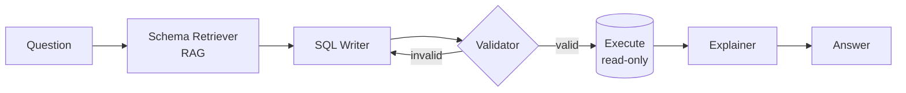

# Multi-Agent Text-to-SQL

Ask a database questions in plain English. A small graph of cooperating agents
retrieves the relevant schema, writes SQL, validates and self-corrects it, runs it
read-only, and explains the result.

> Built on the public **Northwind** dataset so anyone can reproduce it end to end.

<!-- TODO: once it works, drop in a 10-second GIF of a real query here. A GIF at the
top of the README converts a skim-reader faster than any paragraph. -->

## Architecture



The **validate -> rewrite loop** is deliberate: a single LLM call that emits SQL is a
demo; an agent that catches its own bad SQL and fixes it is engineering. That loop is
the thing to point at in an interview.

## Design decisions

<!-- TODO — THIS SECTION IS THE INTERVIEW. Write it yourself, in your own words.
A hiring manager reads this before they read a line of code. Cover:
  - Why multi-agent instead of one big prompt? (separation of concerns, testability,
    the self-correction loop)
  - How does the schema retriever decide what's relevant, and what breaks at 200 tables?
  - Why a separate validator? What does it actually catch?
  - Why SQLite / read-only / these guardrails?
  - One tradeoff you made and what you'd do differently with more time.
Three honest paragraphs here beat a thousand lines of clever code. -->

## Quickstart

```bash
pip install -r requirements.txt
cp .env.example .env        # add your GOOGLE_API_KEY (free: aistudio.google.com/app/apikey)
make data                   # downloads Northwind into ./data
make run                    # serves http://127.0.0.1:8000  (POST /query {"question": "..."})
make eval                   # runs the execution-accuracy eval set
make test                   # runs unit tests
```

## Evaluation

Metric: **execution accuracy** — the agent's SQL is correct if its result set matches a
hand-written gold query's result set (the standard text-to-SQL metric; string-matching
SQL is misleading because many correct queries look different).

<!-- TODO: after you grow evals/cases.yaml to 12-15 cases and run `make eval`,
paste the real results table here. Include the failures honestly — a documented
failure case shows more judgment than a clean 100%. -->

| Difficulty | Cases | Execution accuracy |
|------------|-------|--------------------|
| TODO       | TODO  | TODO               |

## Limitations

<!-- TODO — write these yourself and be specific. e.g. single-DB, no multi-turn
follow-ups, retriever is naive above N tables, no cost/latency budget, etc.
Naming your own limitations is a credibility signal, not a weakness. -->

## Tech stack

Python · FastAPI · SQLite · Gemini (swappable via `src/llm.py`) · pytest
