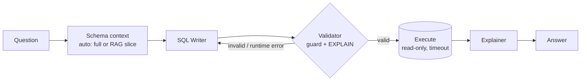

# Multi-Agent Text-to-SQL, with an evaluation harness

[](https://github.com/AmrutGit/multi-agent-text-to-sql/actions/workflows/ci.yml)

- **What:** plain-English questions → schema context → SQL writer → validator with self-correction → read-only execution → explanation. Hand-rolled Python, FastAPI, SQLite.
- **Harness:** BIRD dev loader, execution accuracy with 95% CI, automatic failure taxonomy, p50/p95 latency, $ per question, paired sign test, spend cap (`--max-usd`).
- **Measured so far (no LLM):** on all 1,534 BIRD dev questions the validator rejects 0 gold queries; lexical schema retrieval keeps every needed table on 85.7%.
- **Measured with an LLM:** Claude Haiku 5.5 reaches **68 % execution accuracy** on 200 BIRD dev questions (95 % CI 61–74 %) at **$0.0002 per question** and **5.3 s p95 latency**, with prompt caching serving ~95 % of input tokens.
- **Not measured yet:** Gemini 3.8 Flash (the API returned 503 "high demand" on every call on 2026-11-23).

### Headline results

| Measurement (BIRD dev) | Result | Command |
|---|---|---|
| Validator false rejections on gold SQL | 0 / 1,534 | `python -m evals.audit --dataset bird --data-dir data/bird_raw` |
| Lexical retrieval keeps all needed tables | 85.7% | same |
| Execution accuracy, Gemini 3.8 Flash (n=200, r0 / r2) | not measured yet | `make bench MODELS=gemini-flash N=200` (see below) |
| Execution accuracy, Claude Haiku 5.5 (n=200, r0 / r2) | 65 % / 68 % (95 % CI 58–71 % / 61–74 %) | `make bench MODELS=claude-haiku N=200` |
| Claude Haiku 5.5: p50/p95 latency, $/question (r2) | 2.5 s / 5.3 s, $0.0002 | `make report` |
| Claude Haiku 5.5: self-correction yield, paired p-value r0 vs r2 | 1 of 2 retried questions fixed; p = 0.18 (not significant) | `make report` |

The model rows are filled by pasting the output of `make report` unchanged; no number
in this README is typed by hand.



## Status: what is measured and what is not

| | State |
|---|---|
| Pipeline, validator, self-correction loop, API | Done, 106 automated tests |
| Benchmark harness (BIRD loader, execution accuracy, failure classifier, latency/cost, CI) | Done and validated on the real BIRD dev set (below) |
| Deterministic-component audit on all 1,534 BIRD dev questions | **Measured** (below) |
| **Model accuracy / latency / cost** | **Measured for Claude Haiku 5.5** (below). Gemini 3.8 Flash not run yet: API overloaded (503) on the run date |
| **QLoRA Llama vs API models** | **Not run yet.** The adapter is not in this repo; see [Evaluating the fine-tuned model](#evaluating-the-fine-tuned-model) |

## Results (detail)

### 1. Measured: the parts that need no LLM (all 1,534 BIRD dev questions)

`python -m evals.audit --dataset bird --data-dir data/bird_raw`

| Check | Result |
|---|---|
| Validator false rejections on gold SQL | **0 / 1,534**: the safety guard never blocks a valid benchmark query |
| Harness check: a stand-in "model" that returns the gold SQL, scored on all 1,534 | 1,524 pass. The other 10 are not harness faults: 9 were a lookup bug in the throwaway stand-in script (evidence strings containing newlines), and 1 slow gold query (`bird-596`) hit the 30 s timeout under 8-way load. This validates scoring, not any model |
| Lexical schema retrieval: all needed tables kept | **85.7 %** → a hard ceiling: 14.3 % of questions are unanswerable before the model sees them |
| Prompt size with retrieval vs full schema | 63 % (2.3k vs 3.7k chars): retrieval saves little because BIRD schemas are small |
| Largest BIRD schema | 7.3k chars (~2k tokens) |

Retrieval recall by database shows where it breaks: `debit_card_specializing` 47 %,
`financial` 60 %, `superhero` 66 %, versus `thrombosis_prediction` 100 %.

**Decision driven by this data:** `schema_mode=auto` (default). If the full schema fits a
budget (12k chars) it is sent whole; retrieval is used only for larger schemas. At BIRD
sizes retrieval bought a ~37 % smaller prompt at the cost of a 14 % accuracy ceiling.
That is a bad trade; at BIRD sizes, auto never retrieves. The retriever stays (and is
measured) because it is the right tool once a schema stops fitting in a prompt.

The audit also drove two fixes: sub-word matching ("SAT" → `satscores`, +1 pt overall,
but mixed: `california_schools` 72 → 96 %, `superhero` 90 → 66 %) and removing a
non-determinism bug in join-path selection that made recall vary between runs
(now regression-tested across hash seeds).

### 2. Model results: Claude Haiku 5.5 (Gemini 3.8 Flash pending)

Run 2026-11-23. Configuration: BIRD dev, n=200, stratified by difficulty, seed 0,
`--workers 4` (latency is measured with 4 requests in flight), `--retries 0` and
`--retries 2`, provider-default sampling, effort `medium`, prompt caching on the system
prompt (rules + schema). Model ID and prices (including cache prices) are in
`evals/models.yaml`. Total API spend for both runs: **USD 0.065**. Output of `make report`,
unchanged:

| Model / config | Exec. accuracy | 95% CI | Easy | Medium | Hard | p50 s | p95 s | Tokens in/out | $/question |
|---|---|---|---|---|---|---|---|---|---|
| claude-haiku (r0, auto) | **130/200 (65%)** | 58%–71% | 89/121 | 30/60 | 11/19 | 2.4 | 6.3 | 1999/261 | $0.0002 |
| claude-haiku (r2, auto) | **135/200 (68%)** | 61%–74% | 92/121 | 29/60 | 14/19 | 2.5 | 5.3 | 2017/263 | $0.0002 |

**Failure types** (count of questions)

| Failure type | claude-haiku (r0, auto) | claude-haiku (r2, auto) |
|---|---|---|
| wrong_values | 35 | 32 |
| wrong_columns | 15 | 17 |
| empty_result | 8 | 8 |
| extra_rows | 8 | 7 |
| missing_rows | 3 | 1 |
| timeout | 1 | 0 |

**Self-correction loop**

- claude-haiku (r0, auto): retry triggered on 0 questions, 0 of those ended correct.
- claude-haiku (r2, auto): retry triggered on 2 questions, 1 of those ended correct.

**Paired comparison** (same questions; only discordant pairs carry information)

| A | B | only A correct | only B correct | sign-test p |
|---|---|---|---|---|
| claude-haiku (r0, auto) | claude-haiku (r2, auto) | 2 | 7 | 0.18 |

_p < 0.05 is the usual bar; above it, the difference may be noise at this sample size._

**Prompt caching.** The system prompt (rules + full schema) is identical for every
question on the same database, so it is cached; across both runs 92–96 % of input tokens
were cache reads, billed at 0.1x. Cost is still dominated by output (thinking) tokens,
which caching does not reduce.

**Read it with the right error bars.** At n=50 an accuracy of 60 % is really
"between 46 % and 72 %". Two models 8 points apart are usually statistically
indistinguishable (the report prints a sign-test p-value). Use `N=200` or more before
drawing conclusions; the sample is stratified by difficulty and seeded, so every model
sees identical questions.

## Failure analysis

### How failures are classified

Every wrong answer gets exactly one automatic label (`evals/metrics.py`), so failures
can be counted per model rather than eyeballed:

| Label | Meaning | Typical cause → lever |
|---|---|---|
| `hallucinated_column` / `hallucinated_table` | Invented a name that does not exist (after all retries) | Weak schema grounding → better schema context, value samples, fine-tuning |
| `syntax_error`, `ambiguous_column`, `aggregate_misuse`, `type_error` | Query would not compile | Dialect slips (SQLite vs MySQL) → prompt rules, retry loop |
| `timeout` | Exceeded the time limit | Cartesian joins, missing filters |
| `blocked_by_guard` | Validator refused a non-SELECT / stacked statement | Model ignoring read-only rule |
| `empty_result` | Valid SQL, zero rows, gold had rows | Wrong literal/value format, over-strict filter |
| `wrong_columns` | Different number of output columns | Over/under-selecting; ambiguous question |
| `missing_rows` / `extra_rows` | Result is a strict subset / superset of gold | Wrong filter, join type, `DISTINCT`, `LIMIT` |
| `wrong_values` | Same shape, different values | Wrong aggregation, join key, formula, or ambiguity |
| `llm_error` | Provider failure (auth, rate limit, blocked) | Infra, not model quality: investigate separately |

The first group is *recoverable* by the self-correction loop (the error is fed back);
the result-mismatch group is *invisible* to it, because the SQL ran fine and returned
plausible rows. That asymmetry is the main limit of validate-and-retry: it fixes
compile errors, not wrong logic. The report's "self-correction" line quantifies how much
it helps per model.

Review the actual failures with:

```bash
python -m evals.report --failures evals/results/<run>.jsonl                  # all
python -m evals.report --failures --outcome wrong_values evals/results/<run>.jsonl
```

which prints question, gold SQL, predicted SQL, and error side by side for manual
labelling of *why* (ambiguous question, bad gold, genuine model error).

### Findings so far (measured)

1. **Retrieval was the first failure source and it was mine.** 14.3 % of questions lost
   a required table before generation. Misses cluster where the question's business
   vocabulary does not appear in the DDL: e.g. `financial` questions about "region",
   "salary", "unemployment" need the `district` table, whose columns are opaque codes
   (`A2`, `A11`...). Lexical matching cannot bridge that; column descriptions (BIRD
   ships them) or embeddings could. Fixed for now by `auto` mode, not by a better retriever.
2. **Non-determinism is an eval bug.** Equal-length join paths were chosen by set
   iteration order, so identical runs scored differently. Found only because the audit
   disagreed with itself (85.5 % vs 85.8 %).
3. **The guard is not the bottleneck:** 0 false rejections on 1,534 gold queries.

4. **Haiku's failures are semantic, not syntactic.** Almost every wrong answer is SQL
   that runs but returns the wrong thing (`wrong_values` 32, `wrong_columns` 17 at r2).
   The validator fired a retry on only 2 of 200 questions, so validate-and-retry has
   little to work with: the r0 → r2 gain (65 % → 68 %) is not statistically significant
   (p = 0.18). The next accuracy gains have to come from grounding (column descriptions,
   sample values), not from more retries.

## Evaluating the fine-tuned model

The QLoRA adapter is not part of this repository, so no claim about it is made here.
To compare it fairly:

1. **Serve it behind an OpenAI-compatible endpoint** (the `qlora-llama` entry in
   `evals/models.yaml` already points at `http://localhost:8001/v1`):
   ```bash
   vllm serve <base-model> --enable-lora --lora-modules sql=<adapter_dir> --port 8001
   # or merge + llama.cpp:  llama-server -m merged.gguf --port 8001
   # or Ollama:             set base_url to http://localhost:11434/v1
   ```
2. `make bench MODELS=qlora-llama,claude-haiku,gemini-flash N=200`.

Things that will otherwise make the comparison unfair (check each):

- **Prompt format.** A fine-tuned model expects the prompt it was trained on. This
  harness uses a chat-style system prompt + schema + question + BIRD evidence. If your
  training prompt differs, the adapter's score is understated. Either train/eval on the
  same format or adapt `src/agents/sql_writer.py`. State which you did.
- **Evidence.** BIRD questions come with a hint. Run with and without
  (`--no-evidence`); both are common in published numbers, so say which one you report.
- **Contamination.** Do not evaluate on questions the adapter was trained on. The
  split here is BIRD *dev*; make sure your training data excludes it.
- **Retry budget.** Report `--retries 0` (single shot, pure model quality) and
  `--retries 2` (full system) for every model; the difference is the value of the loop.
- **Latency.** Use `--workers 1` for clean per-question latency; with more workers
  requests queue and p95 reflects load, not the model.
- **Cost.** API models: tokens x price from `models.yaml` (prices copied from the
  providers' pricing pages, with the date read). Local model: API cost is
  zero but GPU time is not: compute `GPU $/hour / (questions/hour)` from a
  `--workers 1` run and add it to the report by hand.

## How to reproduce

```bash
python -m venv .venv && . .venv/bin/activate        # Windows: .venv\Scripts\activate
pip install -r requirements-dev.txt
cp .env.example .env                                # set GEMINI_API_KEY and ANTHROPIC_API_KEY
make data                                           # Northwind (quick demo DB)
make test                                           # no API keys; network only for `make data`
make bird                                           # BIRD dev, one-off ~350 MB
make audit                                          # deterministic audit, no LLM

# the benchmark: 2 models x 2 retry budgets, identical 200 questions
for r in 0 2; do
  python -m evals.benchmark --dataset bird --data-dir data/bird_raw -n 200 --seed 0 \
      --models gemini-flash,claude-haiku --retries $r --workers 1 --max-usd 4
done
make report                                         # paste the output into Results unchanged
python -m evals.report --failures evals/results/gemini-flash__bird__n200__r2__auto.jsonl
```

`make run` serves `POST /query {"question": "..."}` on Northwind. `make eval` is a quick
15-case Northwind sanity check (not the benchmark).

## Evaluation protocol

- **Metric: execution accuracy**, BIRD's official definition: predicted and gold SQL are
  executed; results are compared as sets of rows (column order matters, row order and
  duplicates do not), floats rounded to 4 d.p. SQL text is never compared.
- **Data:** BIRD dev (1,534 questions, 11 databases). Spider is supported by the loader
  (`--dataset spider`, standard `dev.json` + `database/` layout) but has **not** been run
  or verified against the real data; only a synthetic layout test exists.
- **Sampling:** stratified by difficulty, seeded; identical questions for every model.
- **Scoring is uncapped:** the API caps responses at 200 rows, but scoring re-executes
  the predicted SQL without the cap, otherwise large correct answers would be marked wrong.
- **Excluded:** questions whose gold SQL fails to run are reported and excluded.
- **Skips the explainer** during benchmarking: it does not affect SQL correctness but
  adds latency and cost. Latency/cost therefore describe SQL generation + retries.

## Design decisions

<!-- draft: author to rewrite -->

- **Hand-rolled orchestration.** ~40 lines of plain Python; every step debuggable.
- **Defence in depth for safety.** (1) validator: single `SELECT`/`WITH` only; (2)
  `EXPLAIN` checks the plan without running; (3) read-only SQLite connection; (4)
  timeout and row cap. Any one failing still leaves the DB unmodifiable.
- **Validator errors are written for the LLM.** On failure the writer gets its previous
  SQL and the exact SQLite error, so it repairs rather than regenerates.
- **Dataset knowledge is kept out of the generic prompt.** Northwind-specific rules
  live in `NORTHWIND_HINTS`, applied only to that DB, so they cannot mislead on others.
- **LLM isolated in `src/llm.py`.** Agents call `complete(system, user)`; providers
  (Gemini, Anthropic, any OpenAI-compatible server) plug in behind it, and every call
  records latency and token usage for the benchmark. Tests patch one function.
- **No SDKs for Anthropic/OpenAI-compatible:** plain HTTPS with backoff on 429/5xx.

## CI

`.github/workflows/ci.yml` runs on every push and PR (Python 3.10 and 3.11): `ruff`,
then the full test suite. Tests fake all model calls and use tiny SQLite fixtures plus a
fake local HTTP server for the providers, so they need no keys and are fast (~5 s).
`benchmark.yml` is **manual-only** (`workflow_dispatch`): it spends API money, so it
does not run per commit, and it has not been run.

## Limitations

- **One model benchmarked so far** (Claude Haiku 5.5, n=200). No cross-provider
  comparison yet; Gemini 3.8 Flash is pending.
- Lexical retrieval is weak (85.7 % recall on BIRD); `auto` avoids it at current sizes.
  No sample-value or column-description grounding yet, a known big win on BIRD.
- Validate-and-retry cannot catch logically wrong but executable SQL.
- Single-turn; ambiguous questions are guessed, not clarified.
- Spider is supported by the loader (`--dataset spider`) but has not been benchmarked;
  only a synthetic-layout test covers it.
- API models run with provider-default sampling (Claude Haiku 5.5 rejects
  `temperature=0`), so repeated runs can differ. Run-to-run variance is not measured yet.
- The fine-tuned model is evaluated in a separate repo (`text2sql-qlora`), on Spider.
- BIRD gold SQL contains some errors and ambiguities; treat the ceiling as <100 %.

## Tech stack

Python · FastAPI · SQLite · pytest · ruff · GitHub Actions · Gemini / Anthropic /
OpenAI-compatible servers (swappable via `src/llm.py`)
